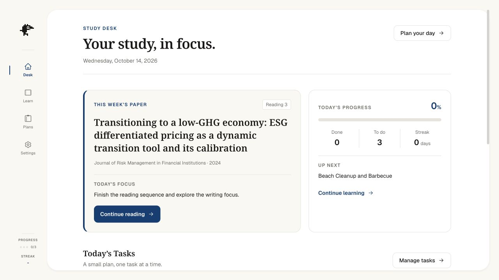

# vibe.web

**Academic Research Desk · 个人英语学习与每日计划助手**

围绕碳中和与绿色金融学习，把日常口语、专业词汇、论文阅读和每日任务放在同一个学习桌面。为 HKUST-GZ 碳中和与绿色金融硕士的个人学习场景设计。

[访问网站](https://vibe-web-production-1f28.up.railway.app) · [使用指南](docs/USAGE.md) · [本地开发](docs/DEVELOPMENT.md) · [Notion 与 AI 配置](docs/INTEGRATIONS.md) · [设计规范](DESIGN.md)



*本地新版首页预览，使用内置示例学习材料。*

## 一个学习桌面，四个入口

| 页面 | 用途 |
| --- | --- |
| **Study Desk** `/` | 查看本周论文、今日学习重点、任务进度和下一步入口 |
| **Learn** `/learn` | 日常对话、论文词汇、阅读片段，以及本周已生成的学习记录 |
| **Plans** `/plans` | 添加、完成和拖动排序任务；从任务池复用常见计划 |
| **Settings** `/settings` | 切换主题、查看活动统计、配置 Notion 和 DeepSeek |

## 核心功能

- **每日口语**：七类生活场景轮换，中英对照、常用表达和练习提示；可选 DeepSeek 生成，未配置或生成失败时使用内置内容。
- **每周论文学习**：同一篇论文贯穿一周，词汇与阅读来自同一条材料；按天分配阅读、词汇和讨论，并附论文元数据与 DOI。
- **每日计划**：学习内容可在当天首次初始化时生成三项任务，支持手动任务、任务池、拖动排序、完成反馈与连续活跃天数。
- **Notion 集成**：保存学习材料；配置启用后，访问学习页面时也会尝试自动推送。任务创建和完成切换会尝试向计划数据库追加记录。
- **主题与布局**：Light / Dark / System 三种主题，桌面侧栏和移动端导航，纸白与深蓝的学术桌面风格。

自动推送由页面访问触发，当前没有每日定时调度。论文材料来自内置学习库，来源原文和引文使用应沿 DOI 回到原论文核对。完整说明见 [使用指南](docs/USAGE.md)。

## 本地运行

需要 **Node.js ≥ 20.9** 和 npm。无需 Notion 或 AI 密钥即可使用基本学习与计划功能。

```bash
git clone https://github.com/biechouwo-coder/vibe-web.git
cd vibe-web

# 已有 .env 时保留原配置，只补充 DATABASE_URL。
cat > .env <<'EOF'
DATABASE_URL="file:./dev.db"
EOF

npm ci
npx prisma db push
npm run dev
```

打开 [localhost:3000](http://localhost:3000)。`.env` 与本地数据库已被 Git 忽略；依赖安装会生成 Prisma Client。更多命令和 PostgreSQL 部署说明见 [开发指南](docs/DEVELOPMENT.md)。

## 文档导航

| 文档 | 内容 |
| --- | --- |
| [使用指南](docs/USAGE.md) | 每日操作流程、每周学习安排、任务与历史记录 |
| [集成配置](docs/INTEGRATIONS.md) | Notion 字段、环境变量、DeepSeek 配置、推送行为 |
| [开发指南](docs/DEVELOPMENT.md) | 环境准备、目录结构、构建、数据库与部署 |
| [设计规范](DESIGN.md) | 视觉方向、色彩、排版和组件约束 |
| [代码协作规则](AGENTS.md) | 修改代码前应阅读的框架说明 |

## 技术栈

Next.js 16 / React 19 / TypeScript / Tailwind CSS 4 / Framer Motion / dnd-kit / Prisma 6。SQLite 用于本地开发，PostgreSQL 用于 Railway 部署；Notion 与 DeepSeek 为可选集成。

## 待完善

- 页面访问之外的每日定时推送。
- 上传和管理自定义学习材料。
- 校验内置论文摘录的原文对应关系。

以上为后续方向，尚未作为已完成功能提供。
